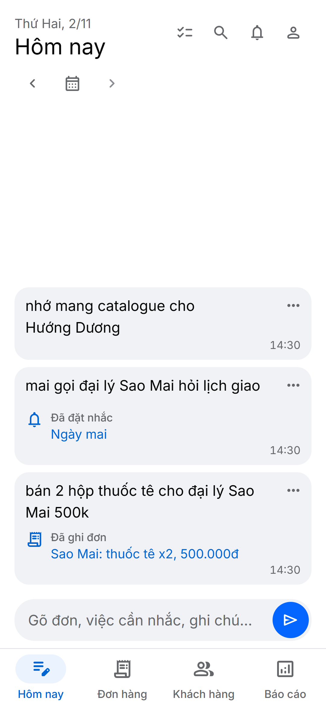
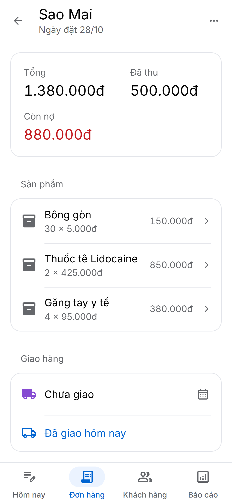
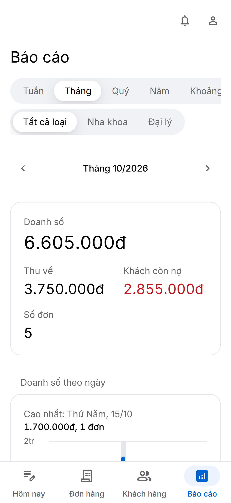

# daybook

[](https://github.com/danganhphu/daybook/actions/workflows/ci.yml)

A notebook for a salesperson on the move: orders, customers and follow-ups, typed the way you would text a friend.
A web app, installable as a PWA, does everything; a Telegram bot is an optional second way in. Both run on one
Cloudflare Worker, on the free plan. The interface is in Vietnamese.

| Today | An order | Reports |
| --- | --- | --- |
|  |  |  |

More: [screenshots](docs/ui/screenshots.md).

## What it does

- **Write it like a note.** "bán 2 hộp thuốc tê cho nk Hướng Dương 500k" becomes the order, "mai gọi nk Sao Mai" a
  reminder, with Undo. The words are kept as typed; a model on Workers AI only sorts them.
- **Orders, customers, products, reminders.** Payments and delivery, what each customer owes, every change logged.
- **Reports.** Any week, month, quarter, year or range, against the one before.
- **It speaks first.** A morning list and a Friday summary by Web Push, in a bell on every tab, and on Telegram.
- **A trash.** Deleted things stay 30 days to restore, then go for good.
- **Two people, one book.** Passkeys (Face ID or a fingerprint), a password as the fallback.

## Quick start

Node 26 and pnpm 12, then:

```sh
pnpm install
pnpm exec cf auth login     # once; opens a browser
pnpm db:migrate
pnpm access:account --username lan --name "Lan" --origin http://localhost:5173 --local
pnpm dev
```

Open the printed link in Chrome or Edge to make a passkey, then http://localhost:5173. More in
[installation](docs/getting-started/installation.md).

## Documentation

| | |
| --- | --- |
| Getting started | [Installation](docs/getting-started/installation.md), [development](docs/getting-started/development.md) |
| Guides | [Configuration](docs/guides/configuration.md), [commands](docs/guides/commands.md), [testing](docs/guides/testing.md), [database](docs/guides/database.md), [deployment](docs/guides/deployment.md), [troubleshooting](docs/guides/troubleshooting.md) |
| Product and design | [Product design](docs/product/design.md), [design system](docs/ui/design-system.md), [screenshots](docs/ui/screenshots.md) |
| Architecture | [Overview](docs/architecture/overview.md), [domain](docs/architecture/domain.md), [security](docs/architecture/security.md) |
| Conventions | [AGENTS.md](AGENTS.md), for people and coding agents alike |

## Stack

TypeScript 7, [vinext](https://github.com/cloudflare/vinext) (the Next.js API on Vite) on Cloudflare Workers, D1
through Drizzle ORM, Workers AI, Queues, Zod, Base UI under a design system in SCSS, SimpleWebAuthn. Tests: Vitest
inside workerd, Playwright with playwright-bdd and axe. Tooling: pnpm, Oxlint, Oxfmt, Stylelint, the `cf` CLI.

## Security

Please report vulnerabilities privately; see [SECURITY.md](SECURITY.md).

## License

None. The source is public to read; all rights are reserved. A personal project with one maintainer; outside pull
requests are not expected.
