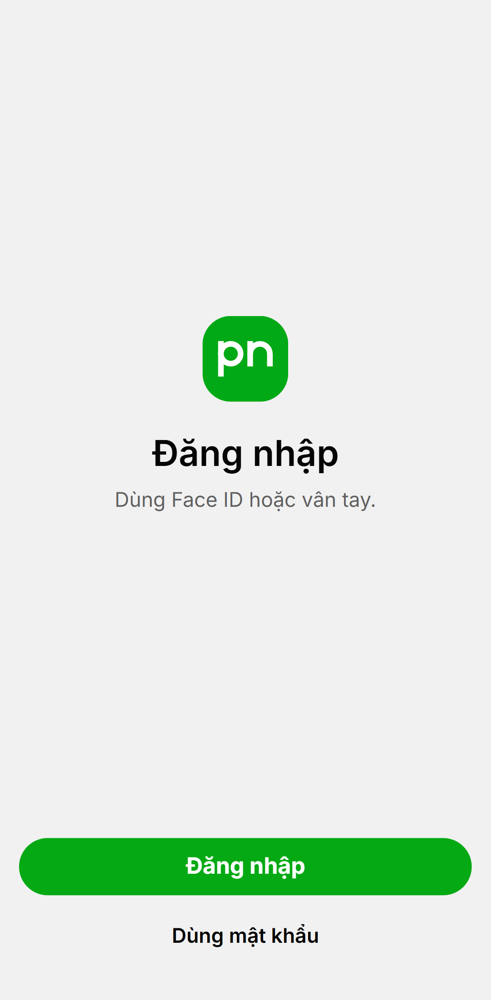
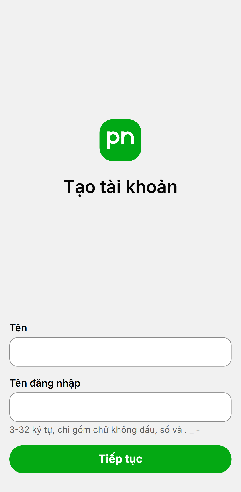
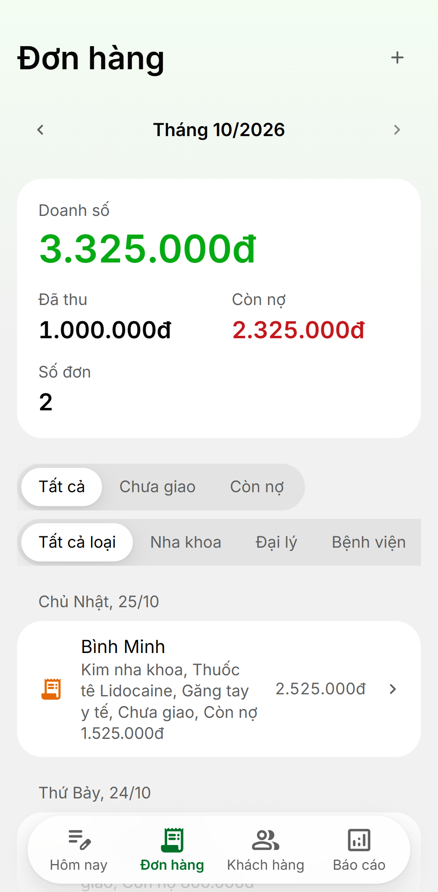
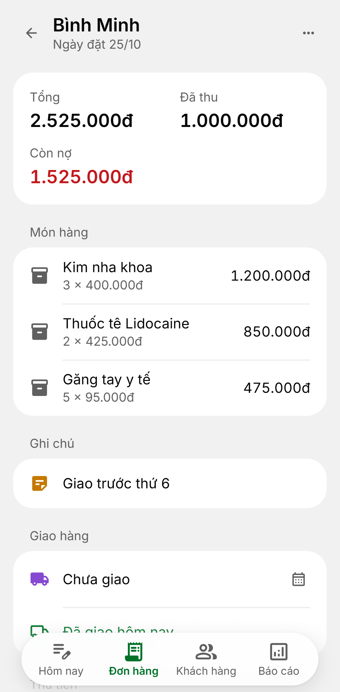
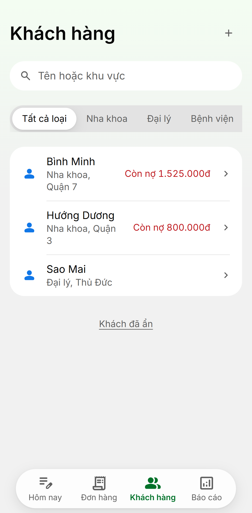
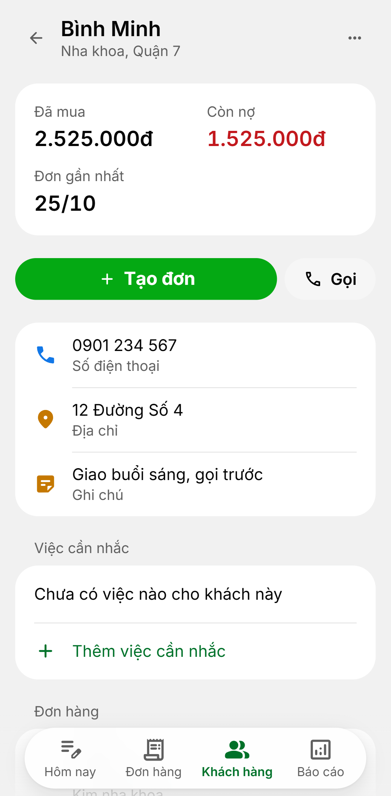
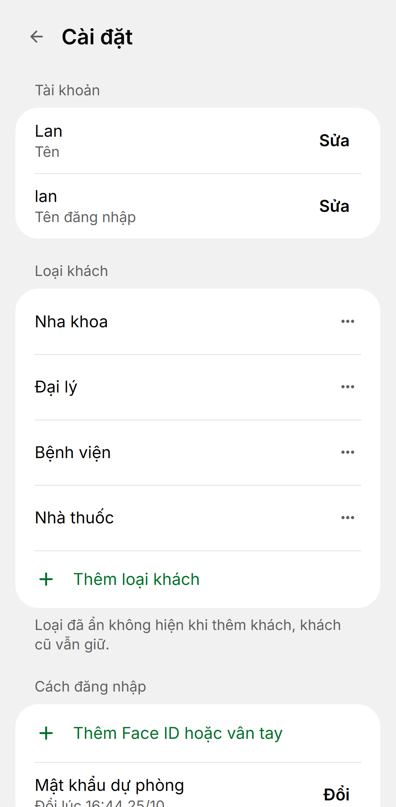
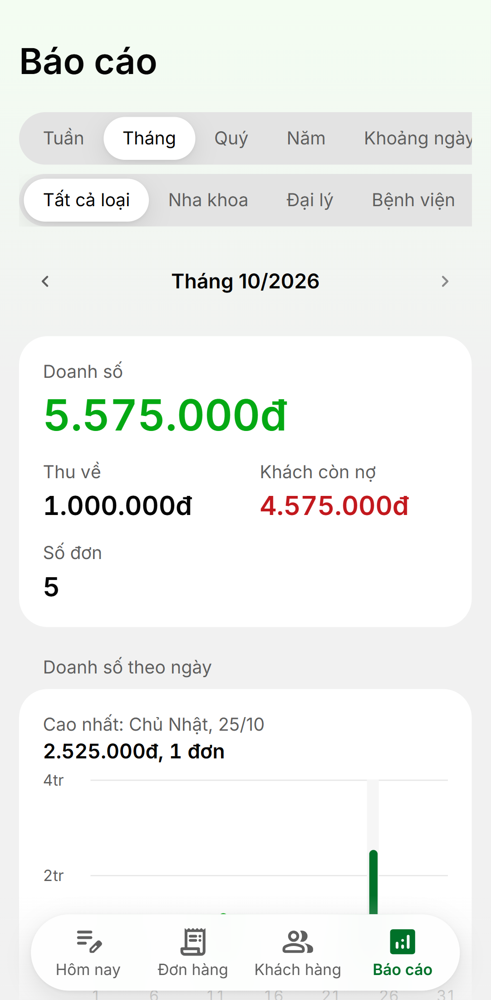
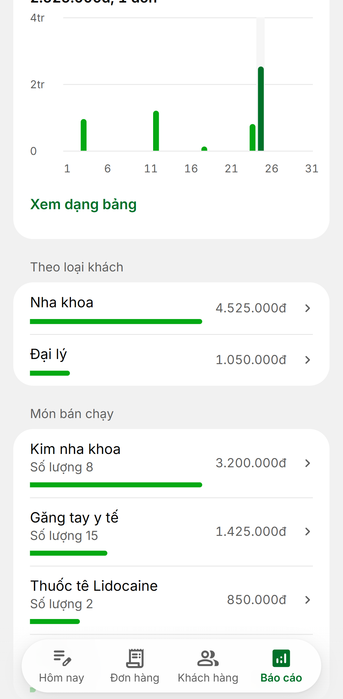
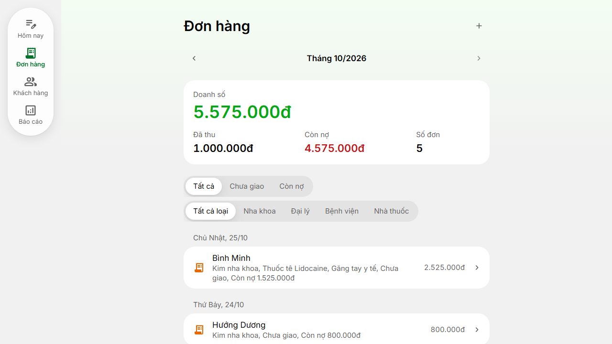

# Screenshots

The web app on an Android phone (Pixel 7), then on a desktop. The data is a made-up book of dental supplies; every
customer is invented. The images live in [`docs/images/`](../images/).

| Sign in | Today | Invited |
| --- | --- | --- |
|  |  |  |

| Orders | An order | Customers |
| --- | --- | --- |
|  |  |  |

| A customer | Settings |
| --- | --- |
|  |  |

| Reports | Reports, further down |
| --- | --- |
|  |  |

On a desktop the tab bar stands down the side:

