# Screenshots

The web app on a Galaxy S24, then on a desktop, taken on 2026-11-02. The book is made up; every name is invented.

| Sign in | Today | Reminders |
| --- | --- | --- |
| 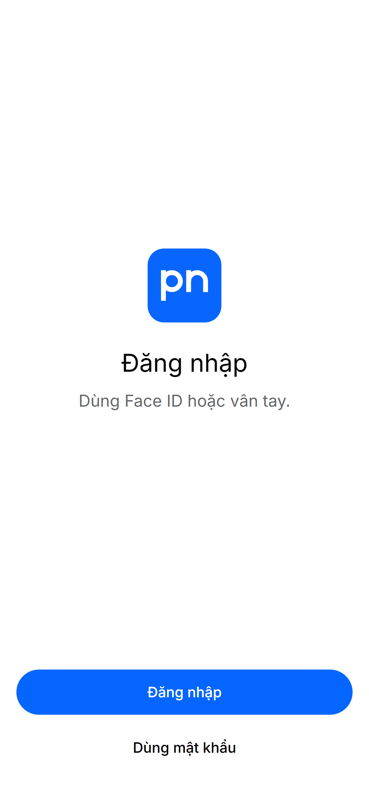 | 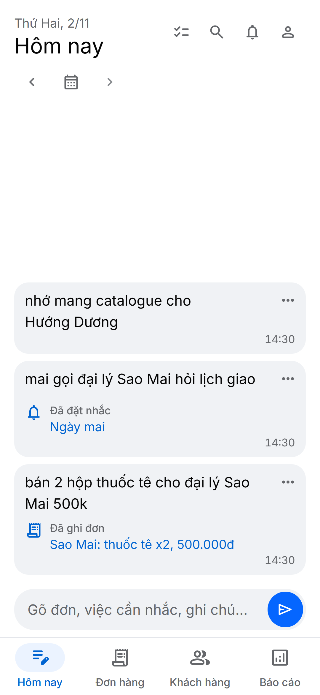 | 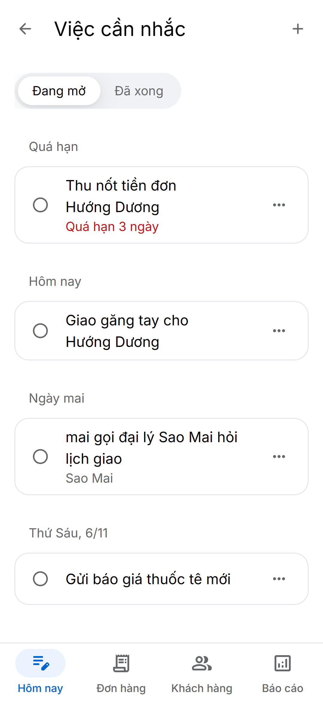 |

| Orders | An order | Customers |
| --- | --- | --- |
| 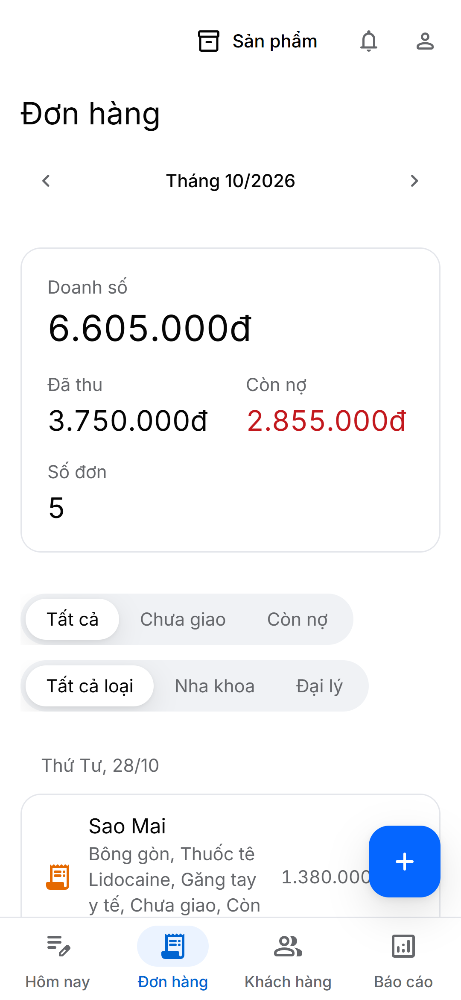 | 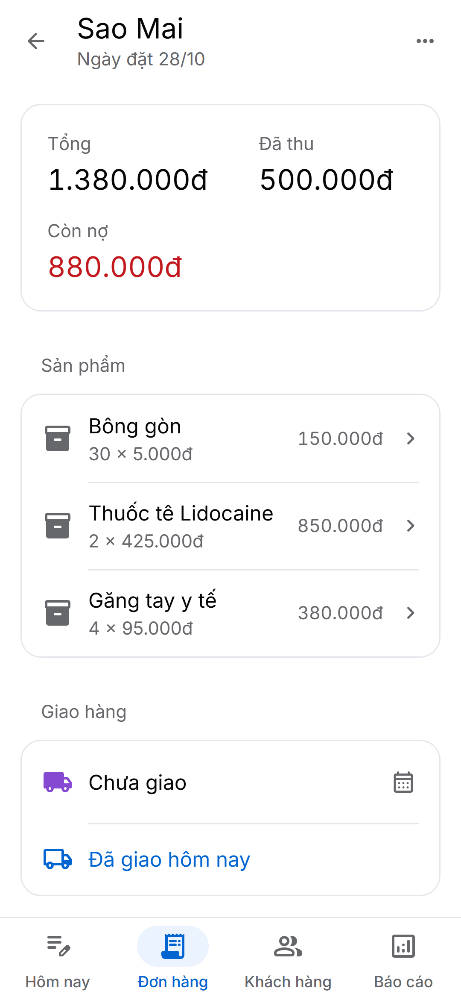 | 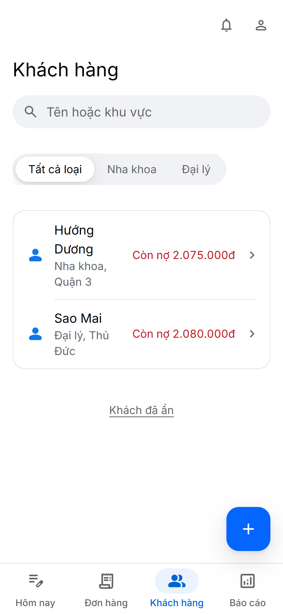 |

| A customer | Reports | Notifications |
| --- | --- | --- |
| 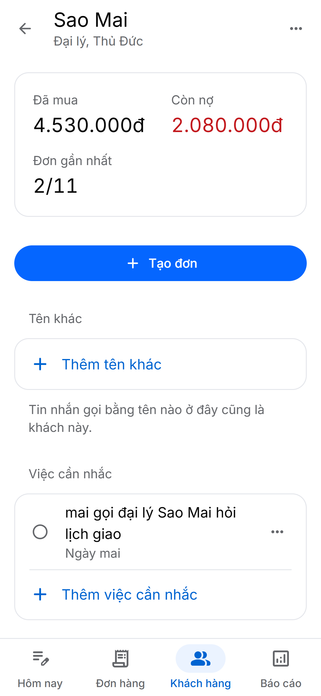 | 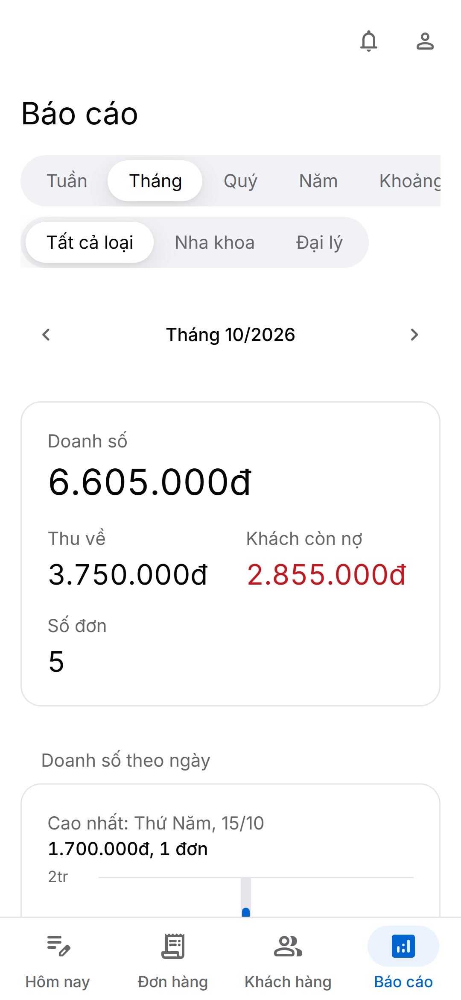 | 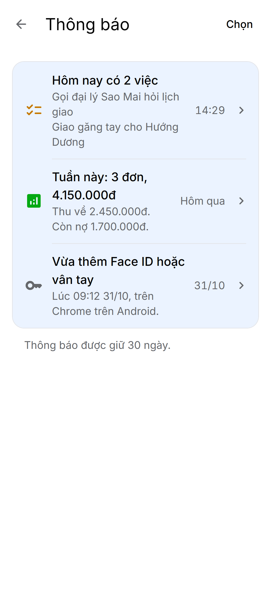 |

| Recently deleted | Settings: notifications |
| --- | --- |
| 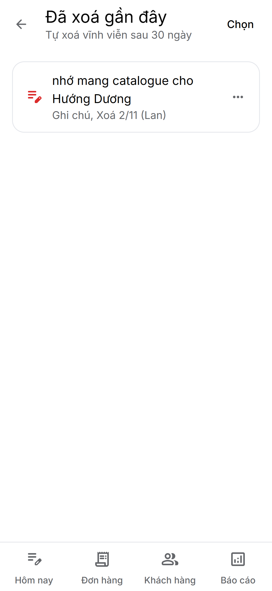 | 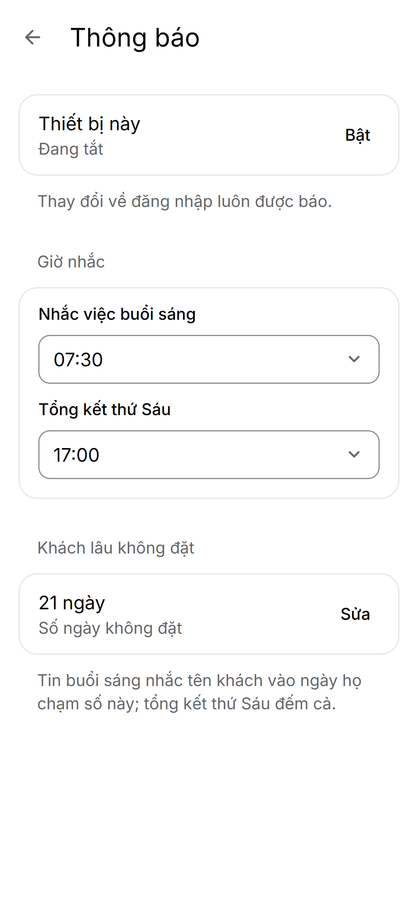 |

On a desktop the tab bar stands down the side:

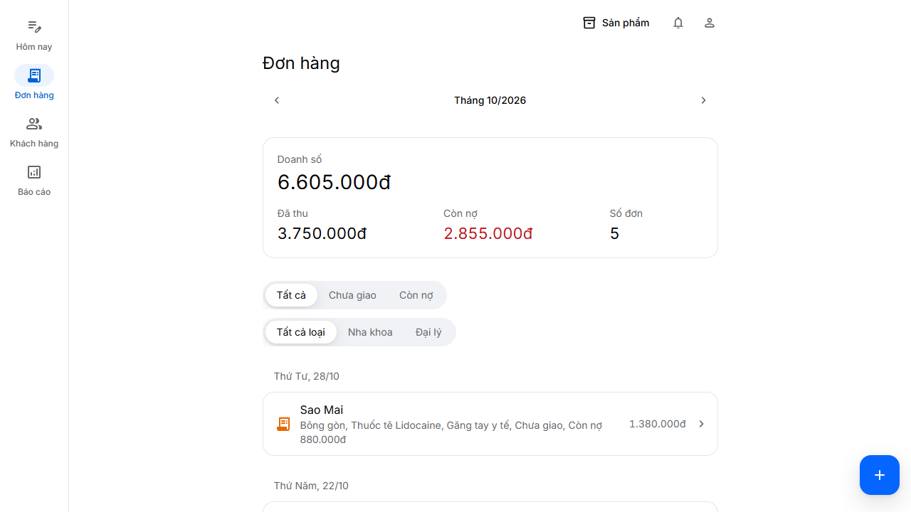
